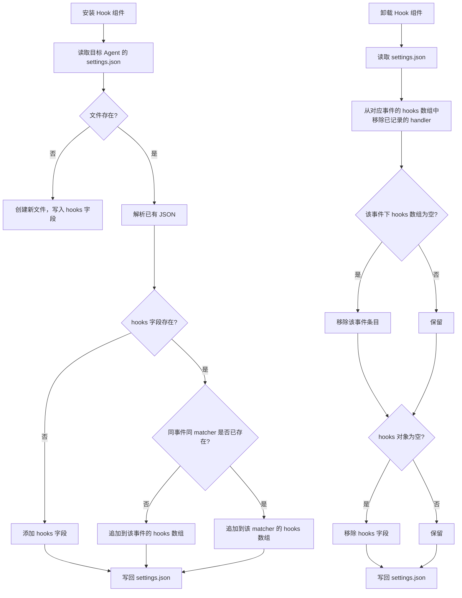
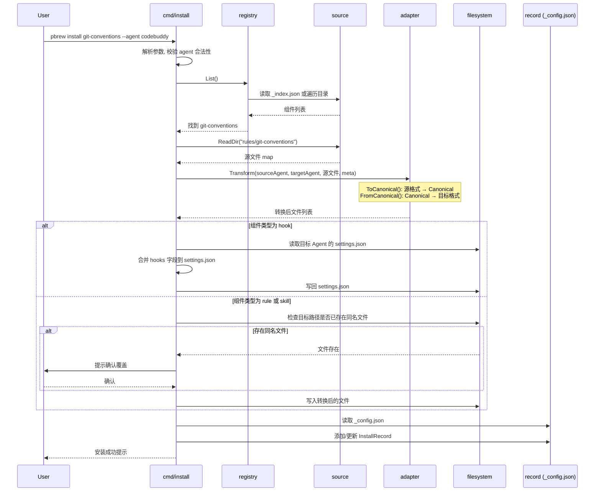
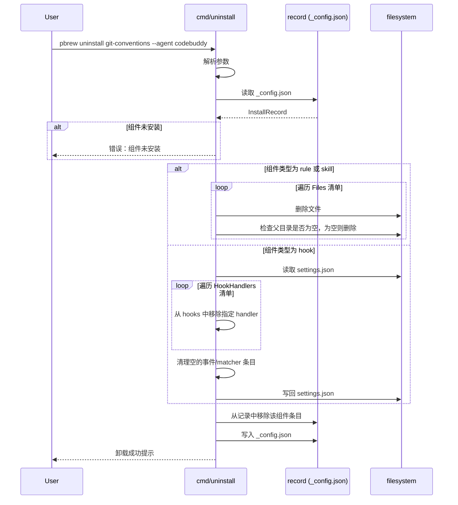
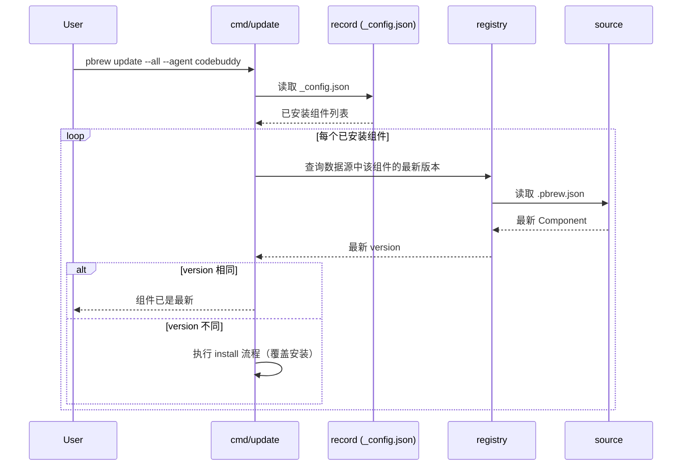
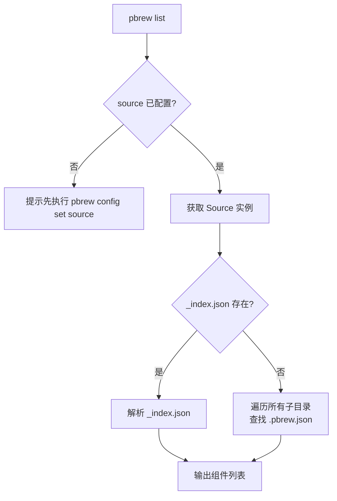
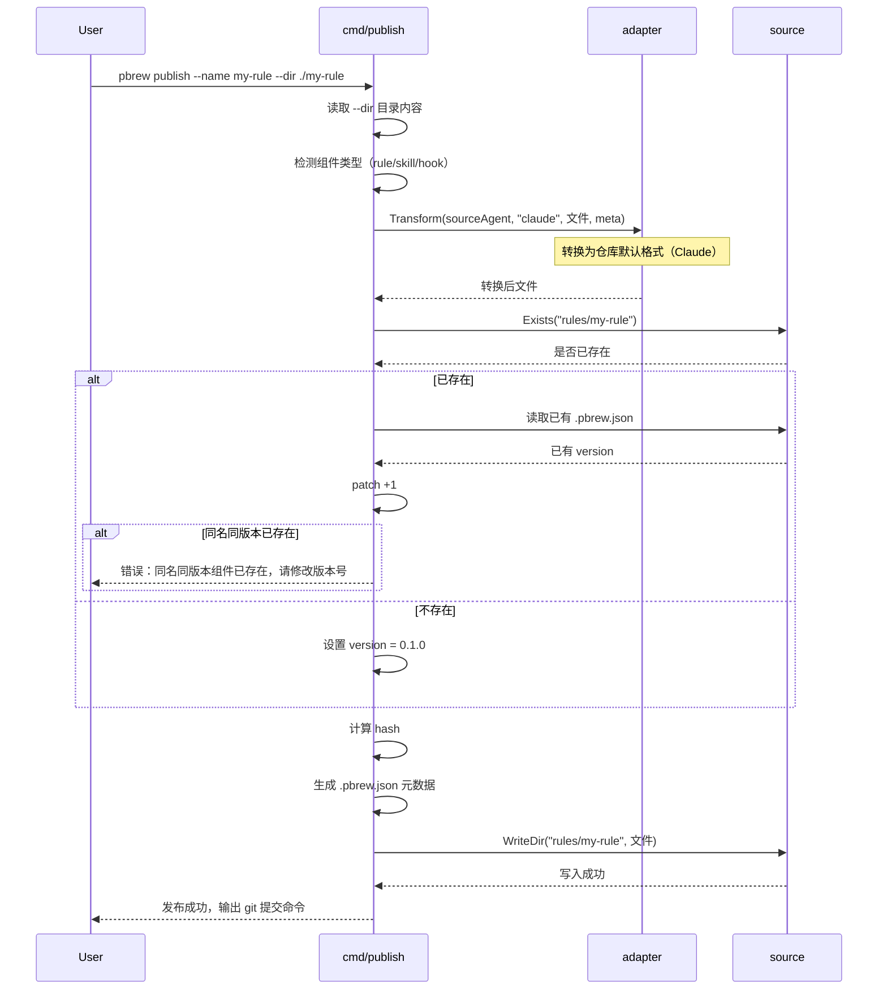
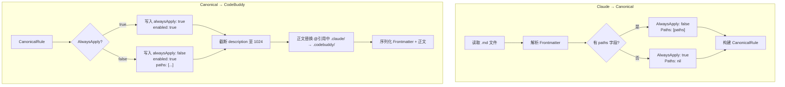
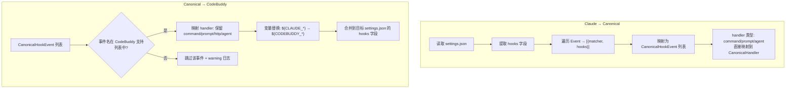
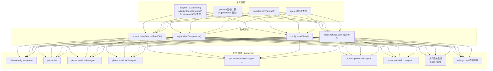

# pbrew — 设计文档

## 1. 技术选型

### 1.1 语言与运行时

| 维度 | 选择 | 理由 |
|------|------|------|
| 语言 | Go 1.23+ | AI 训练数据充足、单二进制分发、标准库覆盖文件操作 |
| CLI 框架 | `github.com/spf13/cobra` | Go CLI 事实标准，AI 生成代码最可靠 |
| YAML 解析 | `gopkg.in/yaml.v3` | 解析 Markdown frontmatter 的唯一第三方依赖 |
| JSON 解析 | `encoding/json` | 标准库 |
| 文件哈希 | `crypto/sha256` | 标准库 |
| Git 操作 | 调用系统 `git` 命令 | 比任一 Go Git 库更简单可靠 |
| 单元测试 | `testing` + `github.com/stretchr/testify` | 标准库 + 轻量断言 |
| E2E 测试 | `github.com/rogpeppe/go-internal/testscript` | Go 官方同源，CLI 测试事实标准 |

### 1.2 依赖清单（最小化原则）

```
github.com/spf13/cobra          # CLI 框架
github.com/spf13/pflag          # cobra 的依赖（自动引入）
gopkg.in/yaml.v3                # YAML frontmatter 解析
github.com/stretchr/testify     # 测试断言
github.com/rogpeppe/go-internal # E2E 测试（testscript）
```

除 Go 标准库外，仅 5 个直接/间接依赖，控制 AI 需理解的上下文范围。

## 2. 项目结构

```
pbrew/
├── main.go                     # 入口：初始化 cobra 根命令并执行
├── cmd/                        # CLI 命令定义（薄层，只做参数解析和编排）
│   ├── root.go                 # 根命令、全局 flag
│   ├── config.go               # pbrew config set/get/list
│   ├── list.go                 # pbrew list
│   ├── install.go              # pbrew install
│   ├── update.go               # pbrew update
│   ├── uninstall.go            # pbrew uninstall
│   └── publish.go              # pbrew publish（P1）
├── internal/                   # 核心业务逻辑（不可被外部导入）
│   ├── model/                  # 数据结构定义
│   │   ├── component.go        # Component, ComponentType, SourceAgent
│   │   ├── record.go           # InstallRecord, RecordStore
│   │   ├── config.go           # Config（source 等）
│   │   └── agent.go            # AgentProfile, FrontmatterConstraints
│   ├── agent/                  # Agent 注册表（数据驱动的 Agent 描述）
│   │   └── registry.go         # 内置 AgentProfile 定义 + 查询接口
│   ├── config/                 # 配置管理
│   │   └── config.go           # 读写 ~/.pbrew/config
│   ├── source/                 # 数据源抽象
│   │   ├── source.go           # Source 接口定义
│   │   ├── local.go            # 本地目录实现
│   │   └── git.go              # Git 仓库实现（clone + 本地缓存）
│   ├── registry/               # 组件发现与索引
│   │   ├── registry.go         # 遍历 + 索引读取
│   │   └── index.go            # _index.json 解析
│   ├── adapter/                # Adapter 管道（Canonical 中转格式转换）
│   │   ├── adapter.go          # Adapter 接口 + Canonical 管道
│   │   ├── canonical.go        # Canonical 数据结构定义
│   │   ├── claude_adapter.go   # Claude ↔ Canonical 双向转换
│   │   ├── codebuddy_adapter.go # CodeBuddy ↔ Canonical 双向转换
│   │   ├── frontmatter.go      # Frontmatter 解析/修改/序列化
│   │   └── path_replace.go    # 路径与变量名替换
│   ├── installer/              # 安装/卸载/更新编排
│   │   ├── install.go          # install 流程
│   │   ├── uninstall.go        # uninstall 流程
│   │   └── update.go           # update 流程
│   ├── publisher/              # 发布逻辑
│   │   └── publish.go          # publish 流程（P1）
│   └── platform/               # 平台相关工具
│       └── paths.go            # 项目根目录查找、Agent 目录路径计算
├── testdata/                   # 共享测试数据
│   └── fixtures/               # 组件样例（用于单元测试）
└── e2e/                        # E2E 测试
    ├── main_test.go            # testscript 入口（TestMain + TestScripts）
    └── testdata/
        └── script/             # .txt 测试脚本
            ├── config_set.txt
            ├── list.txt
            ├── install_rule.txt
            ├── install_skill.txt
            ├── install_hook.txt
            ├── update.txt
            └── uninstall.txt
```

### 2.1 模块职责边界

| 模块 | 职责 | 不负责 |
|------|------|--------|
| `cmd/` | 参数解析、校验、调用 internal、输出结果 | 业务逻辑 |
| `model/` | 纯数据结构定义 | 任何 I/O 操作 |
| `agent/` | Agent 描述的注册与查询 | 任何 I/O 操作 |
| `config/` | 读写 `~/.pbrew/config` | 解释配置语义 |
| `source/` | 将数据源抽象为统一的组件目录访问接口 | 组件内容的解析或转换 |
| `registry/` | 发现和列出可用组件 | 组件的安装或转换 |
| `adapter/` | 文件内容的格式转换（纯函数），通过 Canonical 中转 | 文件 I/O、路径计算 |
| `installer/` | 编排 install/uninstall/update 的完整流程 | 格式转换的细节 |
| `platform/` | 项目根目录查找、Agent 目标路径计算 | 业务逻辑 |

## 3. Agent 可扩展性设计

### 3.1 设计原则

pbrew 要同时支持多种 AI Agent，核心挑战是如何让新增一种 Agent 的工作量最小。采用**数据驱动 + Canonical 中转**策略：

1. **AgentProfile**：用声明式数据描述每个 Agent 的目录约定和 frontmatter 约束，路径计算等逻辑不写 if/else，而是查询 Profile
2. **Canonical 中转**：所有适配器只实现与 Canonical（标准中间表示）的双向转换，新增 Agent 只需写一个 Adapter，无需与其他 Agent 两两配对
3. **组件类型可扩展**：Hook 等新组件类型通过注册机制加入，不影响已有代码

### 3.2 AgentProfile 数据结构

```go
// model/agent.go

// AgentProfile 描述一种 Agent 的目录约定和格式约束
type AgentProfile struct {
    ID           string `json:"id"`            // "claude" | "codebuddy" | "cursor" | ...
    DisplayName  string `json:"displayName"`   // "Claude Code" | "CodeBuddy Code" | ...
    DirName      string `json:"dirName"`       // ".claude" | ".codebuddy" | ".cursor"
    RuleFileName string `json:"ruleFileName"`  // "CLAUDE.md" | "CODEBUDDY.md"
    LocalRuleFileName string `json:"localRuleFileName"` // "CLAUDE.local.md" | ...
    RulesDir     string `json:"rulesDir"`      // "rules"
    SkillsDir    string `json:"skillsDir"`     // "skills"
    SettingsFile string `json:"settingsFile"`  // "settings.json" | ""（无独立设置文件）

    // 各组件类型在这个 Agent 中的存放子目录
    // key 为 ComponentType ("rule"/"skill"/"hook")，value 为相对于 AgentRoot 的子目录
    ComponentDirs map[string]string `json:"componentDirs"`

    // Frontmatter 约束
    FMConstraints FrontmatterConstraints `json:"fmConstraints"`
}

type FrontmatterConstraints struct {
    // 各组件类型支持的 frontmatter 字段白名单
    // key 为 ComponentType，value 为字段名列表
    SupportedFields map[string][]string `json:"supportedFields"`

    // 字段默认值（缺失时需要补充的值）
    // key 为 "componentType.fieldName"，value 为默认值
    DefaultValues map[string]any `json:"defaultValues"`

    // 字段值约束
    // key 为 "componentType.fieldName"，值为约束描述
    FieldConstraints map[string]FieldConstraint `json:"fieldConstraints"`
}

type FieldConstraint struct {
    MaxLength int    `json:"maxLength,omitempty"` // 0 = 无限制
    Behavior  string `json:"behavior,omitempty"`  // 语义行为规则描述
}
```

### 3.3 内置 AgentProfile 注册表

```go
// agent/registry.go

var builtIn = map[string]AgentProfile{
    "claude": {
        ID:                "claude",
        DisplayName:       "Claude Code",
        DirName:           ".claude",
        RuleFileName:      "CLAUDE.md",
        LocalRuleFileName: "CLAUDE.local.md",
        RulesDir:          "rules",
        SkillsDir:         "skills",
        SettingsFile:      "settings.json",
        ComponentDirs: map[string]string{
            "rule":  "rules",
            "skill": "skills",
            "hook":  "", // Claude hooks 在 settings.json 中，无独立目录
        },
        FMConstraints: FrontmatterConstraints{
            SupportedFields: map[string][]string{
                "rule":  {"paths"},
                "skill": {"description", "when_to_use", "allowed-tools", "disallowed-tools",
                          "disable-model-invocation", "user-invocable", "context", "agent", "model"},
            },
            FieldConstraints: map[string]FieldConstraint{
                "skill.description": {MaxLength: 0}, // 无限制
            },
        },
    },
    "codebuddy": {
        ID:                "codebuddy",
        DisplayName:       "CodeBuddy Code",
        DirName:           ".codebuddy",
        RuleFileName:      "CODEBUDDY.md",
        LocalRuleFileName: "CODEBUDDY.local.md",
        RulesDir:          "rules",
        SkillsDir:         "skills",
        SettingsFile:      "settings.json",
        ComponentDirs: map[string]string{
            "rule":  "rules",
            "skill": "skills",
            "hook":  "", // CodeBuddy hooks 在 settings.json 中，无独立目录
        },
        FMConstraints: FrontmatterConstraints{
            SupportedFields: map[string][]string{
                "rule":  {"description", "alwaysApply", "enabled", "paths", "updatedAt", "provider"},
                "skill": {"description", "allowed-tools",
                          "disable-model-invocation", "user-invocable", "context", "agent", "model"},
            },
            DefaultValues: map[string]any{
                "rule.alwaysApply": true,
                "rule.enabled":     true,
            },
            FieldConstraints: map[string]FieldConstraint{
                "skill.description":       {MaxLength: 1024},
                "rule.alwaysApply":        {Behavior: "alwaysApply:false + no paths → rule not loaded"},
                "rule.alwaysApply_noPaths": {Behavior: "alwaysApply:false + no paths → rule not loaded"},
            },
        },
    },
}

func Get(id string) (AgentProfile, bool) { ... }
func List() []AgentProfile { ... }
```

### 3.4 新增 Agent 的工作量

| 步骤 | 工作内容 | 改动范围 |
|------|---------|---------|
| 1 | 在 `agent/registry.go` 添加 `AgentProfile` | 1 个文件 |
| 2 | 实现 `adapter/<new_agent>_adapter.go`（FromCanonical + ToCanonical） | 1 个文件 + 测试 |
| 3 | 无需改动 `platform/`、`cmd/`、`installer/` | — |

路径计算由 `AgentProfile` 驱动，适配逻辑由新 Adapter 承担，**零改动已有代码**。

## 4. Canonical 中转适配管道

### 4.1 核心思路

```
源格式 → ToCanonical() → Canonical → FromCanonical() → 目标格式
```

每个 Agent 只需实现两个方向的转换，新增 Agent 是 O(1) 工作量，而非 O(N²)。

### 4.2 Canonical 数据结构

Canonical 是 pbrew 定义的**内部标准表示**，与任何特定 Agent 无关。它包含了 Rule、Skill、Hook 三类组件的完整语义信息：

```go
// adapter/canonical.go

// CanonicalComponent 表示一个组件的标准中间格式
type CanonicalComponent struct {
    Meta    CanonicalMeta    `json:"meta"`
    Rule    *CanonicalRule   `json:"rule,omitempty"`
    Skill   *CanonicalSkill  `json:"skill,omitempty"`
    Hook    *CanonicalHook   `json:"hook,omitempty"`
    Files   []CanonicalFile  `json:"files"`
}

type CanonicalMeta struct {
    Name        string `json:"name"`
    Version     string `json:"version"`
    Type        string `json:"type"`        // "rule" | "skill" | "hook"
    Description string `json:"description"`
    SourceAgent string `json:"sourceAgent"` // 源 Agent 标识
    Hash        string `json:"hash"`
    UpdatedAt   string `json:"updatedAt,omitempty"`
}

// CanonicalRule — Rule 组件的语义信息
type CanonicalRule struct {
    // alwaysApply: true = 始终加载, false = 条件触发
    AlwaysApply bool     `json:"alwaysApply"`
    // 触发规则的文件 glob 模式，nil = 无条件触发
    Paths       []string `json:"paths,omitempty"`
}

// CanonicalSkill — Skill 组件的语义信息
type CanonicalSkill struct {
    Description           string   `json:"description"`
    WhenToUse             string   `json:"whenToUse,omitempty"`
    AllowedTools          []string `json:"allowedTools,omitempty"`
    DisallowedTools       []string `json:"disallowedTools,omitempty"`
    DisableModelInvocation bool     `json:"disableModelInvocation"`
    UserInvocable         bool     `json:"userInvocable"`
    Context               string   `json:"context,omitempty"`   // "fork" | ""
    Agent                 string   `json:"agent,omitempty"`
    Model                 string   `json:"model,omitempty"`     // "default" | "lite" | "reasoning"
}

// CanonicalHook — Hook 组件的语义信息
type CanonicalHook struct {
    // 事件注册列表
    Events []CanonicalHookEvent `json:"events"`
}

type CanonicalHookEvent struct {
    EventName string              `json:"eventName"` // "PreToolUse", "PostToolUse", "Stop", ...
    Matcher   string              `json:"matcher,omitempty"`
    Handlers  []CanonicalHandler  `json:"handlers"`
}

type CanonicalHandler struct {
    Type       string            `json:"type"`                 // "command" | "prompt" | "http" | "agent"
    Command    string            `json:"command,omitempty"`    // type=command
    Prompt     string            `json:"prompt,omitempty"`     // type=prompt / agent
    URL        string            `json:"url,omitempty"`        // type=http
    Method     string            `json:"method,omitempty"`     // type=http
    Headers    map[string]string `json:"headers,omitempty"`    // type=http
    Model      string            `json:"model,omitempty"`      // type=prompt / agent
    Timeout    int               `json:"timeout,omitempty"`    // 秒
    If         string            `json:"if,omitempty"`         // 权限规则过滤
    Once       bool              `json:"once,omitempty"`       // 仅执行一次
    Async      bool              `json:"async,omitempty"`      // 异步执行
    AsyncRewake bool             `json:"asyncRewake,omitempty"` // 异步 + 唤醒
}

// CanonicalFile — 组件中的一个文件
type CanonicalFile struct {
    // 相对于组件根目录的路径，使用正斜杠
    RelPath string `json:"relPath"`
    // 文件内容
    Content []byte `json:"content"`
}
```

### 4.3 Adapter 接口

```go
// adapter/adapter.go

// Adapter Agent 适配器接口，实现 Canonical 双向转换
type Adapter interface {
    // FromCanonical 将 Canonical 转换为目标 Agent 的文件格式
    FromCanonical(canonical *CanonicalComponent) ([]CanonicalFile, error)

    // ToCanonical 将源 Agent 的文件格式转换为 Canonical
    ToCanonical(files []CanonicalFile, meta CanonicalMeta) (*CanonicalComponent, error)

    // AgentID 返回该适配器对应的 Agent 标识
    AgentID() string
}

// NewAdapter 根据目标 Agent 标识创建适配器
func NewAdapter(agentID string) (Adapter, error) {
    switch agentID {
    case "claude":
        return &ClaudeAdapter{}, nil
    case "codebuddy":
        return &CodeBuddyAdapter{}, nil
    default:
        return nil, fmt.Errorf("unsupported agent: %s", agentID)
    }
}

// Transform 执行完整的格式转换：源 → Canonical → 目标
// sourceAgent: 源文件的 Agent 格式标识
// targetAgent: 目标 Agent 标识
// files: 源文件列表
// meta: 组件元数据
func Transform(sourceAgent, targetAgent string, files []CanonicalFile, meta CanonicalMeta) ([]CanonicalFile, error) {
    // 如果源和目标相同，直接返回（恒等转换）
    if sourceAgent == targetAgent {
        return files, nil
    }

    // 源 → Canonical
    srcAdapter, err := NewAdapter(sourceAgent)
    if err != nil {
        return nil, fmt.Errorf("source adapter: %w", err)
    }
    canonical, err := srcAdapter.ToCanonical(files, meta)
    if err != nil {
        return nil, fmt.Errorf("to canonical: %w", err)
    }

    // Canonical → 目标
    tgtAdapter, err := NewAdapter(targetAgent)
    if err != nil {
        return nil, fmt.Errorf("target adapter: %w", err)
    }
    result, err := tgtAdapter.FromCanonical(canonical)
    if err != nil {
        return nil, fmt.Errorf("from canonical: %w", err)
    }

    return result, nil
}
```

### 4.4 转换管道流程


### 4.5 Claude Adapter 实现要点

**ToCanonical（Claude 文件 → Canonical）：**

| 组件类型 | 转换逻辑 |
|---------|---------|
| Rule | 解析 frontmatter：有 `paths` → `AlwaysApply: false, Paths: [paths]`；无 frontmatter → `AlwaysApply: true` |
| Skill | 解析 SKILL.md frontmatter：保留所有字段映射到 CanonicalSkill；`allowed-tools` → `AllowedTools`；`when_to_use` → `WhenToUse` |
| Hook | 解析 settings.json 中 `hooks` 字段：将嵌套的 `Event → [{matcher, hooks}]` 结构映射为 `CanonicalHookEvent` 列表 |

**FromCanonical（Canonical → Claude 文件）：**

| 组件类型 | 转换逻辑 |
|---------|---------|
| Rule | `AlwaysApply: true` → 无 frontmatter（或仅保留 paths 为空）；`AlwaysApply: false` + 有 Paths → frontmatter 写入 `paths` |
| Skill | 写入 SKILL.md frontmatter：输出 Claude 支持的字段；`WhenToUse` → `when_to_use`；`DisallowedTools` → `disallowed-tools` |
| Hook | 将 CanonicalHookEvent 列表序列化为 settings.json 的 `hooks` 字段 |

### 4.6 CodeBuddy Adapter 实现要点

**ToCanonical（CodeBuddy 文件 → Canonical）：**

| 组件类型 | 转换逻辑 |
|---------|---------|
| Rule | 解析 frontmatter：`alwaysApply` → `AlwaysApply`；`paths` → `Paths`；忽略 `updatedAt`、`provider` 等 IDE 自动管理字段 |
| Skill | 解析 SKILL.md frontmatter：同 Claude，但无 `when_to_use`、`disallowed-tools` 字段 |
| Hook | 解析 settings.json 中 `hooks` 字段：结构兼容 Claude（CodeBuddy 兼容 Claude 规范），直接映射；额外支持 `http` 类型 handler |

**FromCanonical（Canonical → CodeBuddy 文件）：**

| 组件类型 | 转换逻辑 |
|---------|---------|
| Rule | 写入 frontmatter：输出 `alwaysApply`、`enabled: true`、`paths`（如有）；截断 `description` 至 1024 字符 |
| Skill | 写入 SKILL.md frontmatter：跳过 `when_to_use`、`disallowed-tools`；截断 `description` 至 1024 字符 |
| Hook | 序列化为 settings.json 的 `hooks` 字段：保留所有 handler 类型（command、prompt、http、agent）；跳过 CodeBuddy 不支持的事件类型 |

### 4.7 Hook 适配的特殊考量

Hook 是三类组件中适配复杂度最高的，原因如下：

**1. 载体差异**

| Agent | Hook 存储位置 | 格式 |
|-------|-------------|------|
| Claude | settings.json `hooks` 字段 | JSON |
| CodeBuddy | settings.json `hooks` 字段 | JSON（兼容 Claude 规范） |

两者都以 settings.json 为载体，结构高度相似。但 Hook 可能与 Agent 已有的 settings.json 中其他配置（如 permissions、env 等）共存，不能简单覆盖整个文件，必须做**字段级合并**。

**2. 事件差异**

| 事件类别 | Claude 支持 | CodeBuddy 支持 | 适配策略 |
|---------|-----------|---------------|---------|
| 工具生命周期 | PreToolUse, PostToolUse, PostToolUseFailure | PreToolUse, PostToolUse, PostToolUseFailure | 直接映射 |
| 会话生命周期 | SessionStart, SessionEnd | SessionStart, SessionEnd | 直接映射 |
| 停止/子代理 | Stop, StopFailure, SubagentStart, SubagentStop | Stop, StopFailure, SubagentStart, SubagentStop | 直接映射 |
| 用户交互 | UserPromptSubmit, UserPromptExpansion, Notification | UserPromptSubmit, UserPromptExpansion, Notification | 直接映射 |
| 权限 | PermissionRequest, PermissionDenied | PermissionRequest, PermissionDenied | 直接映射 |
| 压缩 | PreCompact, PostCompact | PreCompact, PostCompact | 直接映射 |
| 文件/环境 | FileChanged, CwdChanged | FileChanged, CwdChanged | 直接映射 |
| 任务/团队 | TaskCreated, TaskCompleted, TeammateIdle | TaskCreated, TaskCompleted, TeammateIdle | 直接映射 |
| 工作树 | WorktreeCreate, WorktreeRemove | WorktreeCreate, WorktreeRemove | 直接映射 |
| MCP | Elicitation, ElicitationResult | Elicitation, ElicitationResult | 直接映射 |
| 配置 | ConfigChange, InstructionsLoaded | ConfigChange, InstructionsLoaded | 直接映射 |
| 设置/启动 | Setup | Setup | 直接映射 |
| 消息展示 | MessageDisplay | MessageDisplay | 直接映射 |

> Claude 和 CodeBuddy 的事件集高度重叠（CodeBuddy 兼容 Claude 规范）。对于目标 Agent 不支持的事件，FromCanonical 时跳过该事件映射，并记录 warning 日志。

**3. Handler 类型差异**

| Handler 类型 | Claude | CodeBuddy | 适配策略 |
|-------------|--------|-----------|---------|
| command | ✅ | ✅ | 直接映射 |
| prompt | ✅ | ✅ | 直接映射 |
| http | ❌ | ✅ | Claude → CodeBuddy 直接保留；反向转换时跳过 + warning |
| agent | ✅ | ✅ | 直接映射 |
| mcp_tool | ✅ | ❌ | CodeBuddy → Claude 直接保留；反向转换时跳过 + warning |

**4. 变量占位符替换**

与 Rule/Skill 相同的处理策略：

| 变量 | Claude | CodeBuddy |
|------|--------|-----------|
| 项目目录 | `${CLAUDE_PROJECT_DIR}` | `${CODEBUDDY_PROJECT_DIR}` |
| 插件根目录 | `${CLAUDE_PLUGIN_ROOT}` | `${CODEBUDDY_PLUGIN_ROOT}` |
| 插件数据目录 | `${CLAUDE_PLUGIN_DATA}` | `${CODEBUDDY_PLUGIN_DATA}` |

**5. settings.json 合并策略**



**6. InstallRecord 对 Hook 的记录方式**

```go
// Hook 组件的 InstallRecord.Files 特殊结构：

// HookHandlerRecord 记录单个已安装的 Hook handler
type HookHandlerRecord struct {
    EventName string `json:"eventName"` // "PreToolUse"
    Matcher   string `json:"matcher"`   // "Bash" 或 ""
    // HandlerIndex 在该 matcher 的 hooks 数组中的索引位置
    // 用于卸载时精确定位
    HandlerIndex int `json:"handlerIndex"`
}

// Hook 组件的 InstallRecord.Files 存储的不是文件路径，
// 而是 HookHandlerRecord 列表的 JSON 序列化
```

## 5. 核心数据结构

### 5.1 Component（组件元数据）

```go
// model/component.go

type ComponentType string

const (
    TypeRule  ComponentType = "rule"
    TypeSkill ComponentType = "skill"
    TypeHook  ComponentType = "hook"
)

type SourceAgent string

const (
    SourceClaude   SourceAgent = "claude"
    SourceCodebody SourceAgent = "codebuddy"
)

// Component 对应 .pbrew.json 的数据结构
type Component struct {
    Name        string        `json:"name"`
    Version     string        `json:"version"`
    Type        ComponentType `json:"type"`
    Description string        `json:"description"`
    Hash        string        `json:"hash"`
    UpdatedAt   string        `json:"updatedAt,omitempty"`
    SourceAgent SourceAgent   `json:"sourceAgent,omitempty"`
}
```

### 5.2 InstallRecord（安装记录）

```go
// model/record.go

// InstalledFile 记录单个已安装文件的相对路径
type InstalledFile struct {
    RelPath string `json:"relPath"`
}

// InstallRecord 记录单个已安装组件的信息
type InstallRecord struct {
    Name    string         `json:"name"`
    Version string         `json:"version"`
    Type    ComponentType  `json:"type"`
    Agent   string         `json:"agent"`
    Scope   string         `json:"scope"`
    Source  string         `json:"source"`
    // Rule/Skill 使用 Files 记录已安装文件清单
    Files   []InstalledFile `json:"files,omitempty"`
    // Hook 使用 HookHandlers 记录已安装的 handler 位置
    HookHandlers []HookHandlerRecord `json:"hookHandlers,omitempty"`
}

// HookHandlerRecord 记录单个已安装的 Hook handler 定位信息
type HookHandlerRecord struct {
    EventName    string `json:"eventName"`
    Matcher      string `json:"matcher"`
    HandlerIndex int    `json:"handlerIndex"`
}

// RecordStore 对应 .pbrew/_config.json 的完整结构
type RecordStore struct {
    Version int             `json:"version"`
    Records []InstallRecord `json:"records"`
}
```

## 6. 关键流程

### 6.1 pbrew install 流程



### 6.2 pbrew uninstall 流程



### 6.3 pbrew update 流程



### 6.4 pbrew list 流程



### 6.5 pbrew publish 流程（P1）



## 7. 核心模块实现细节

### 7.1 adapter — Canonical 中转格式转换引擎

#### 7.1.1 Rule 适配流程（Claude ↔ Canonical ↔ CodeBuddy）



#### 7.1.2 Skill 适配流程（Claude ↔ Canonical ↔ CodeBuddy）

| 方向 | 字段映射 |
|------|---------|
| Claude → Canonical | `when_to_use` → `WhenToUse`; `allowed-tools` → `AllowedTools`; `disallowed-tools` → `DisallowedTools` |
| Canonical → CodeBuddy | 跳过 `WhenToUse`（CodeBuddy 不支持）; 跳过 `DisallowedTools`（CodeBuddy 不支持）; `Description` 超过 1024 字符时截断 |
| CodeBuddy → Canonical | 无 `WhenToUse`; 无 `DisallowedTools` |
| Canonical → Claude | `WhenToUse` 为空时不输出; `DisallowedTools` 为空时不输出 |

#### 7.1.3 Hook 适配流程（Claude ↔ Canonical ↔ CodeBuddy）



#### 7.1.4 Frontmatter 解析与序列化

Markdown 文件结构：

```
---yaml
<frontmatter>
---
<markdown body>
```

解析策略：
1. 按行扫描，找到首行 `---` 和第二个 `---`
2. 中间部分用 `gopkg.in/yaml.v3` 解析为 `map[string]interface{}`
3. 修改 map 内容
4. 重新序列化为 YAML，拼回原文件

> 注意：必须保留原始 Markdown 正文不变，仅修改 frontmatter 部分。序列化时需保持 YAML 缩进风格一致。

#### 7.1.5 路径与变量替换

替换规则表：

| 替换对象 | Claude → CodeBuddy | CodeBuddy → Claude |
|---------|-------------------|-------------------|
| 目录名 | `.claude/` → `.codebuddy/` | `.codebuddy/` → `.claude/` |
| 主文件名 | `CLAUDE.md` → `CODEBUDDY.md` | `CODEBUDDY.md` → `CLAUDE.md` |
| 本地文件名 | `CLAUDE.local.md` → `CODEBUDDY.local.md` | `CODEBUDDY.local.md` → `CLAUDE.local.md` |
| Skill 目录变量 | `${CLAUDE_SKILL_DIR}` → `${CODEBUDDY_SKILL_DIR}` | `${CODEBUDDY_SKILL_DIR}` → `${CLAUDE_SKILL_DIR}` |
| 项目目录变量 | `${CLAUDE_PROJECT_DIR}` → `${CODEBUDDY_PROJECT_DIR}` | `${CODEBUDDY_PROJECT_DIR}` → `${CLAUDE_PROJECT_DIR}` |
| 插件根目录变量 | `${CLAUDE_PLUGIN_ROOT}` → `${CODEBUDDY_PLUGIN_ROOT}` | `${CODEBUDDY_PLUGIN_ROOT}` → `${CLAUDE_PLUGIN_ROOT}` |
| 插件数据目录变量 | `${CLAUDE_PLUGIN_DATA}` → `${CODEBUDDY_PLUGIN_DATA}` | `${CODEBUDDY_PLUGIN_DATA}` → `${CLAUDE_PLUGIN_DATA}` |
| `@` 引用中的路径 | `.claude/` → `.codebuddy/` | `.codebuddy/` → `.claude/` |

> CodeBuddy 兼容 `${CLAUDE_*}` 别名，因此正向替换是增强性的（更规范），反向替换是功能必需的。

### 7.2 source — 数据源访问

#### 7.2.1 本地目录

```go
type LocalSource struct {
    root string // 绝对路径
}
```

直接以目录为根，`ReadDir` 读取相对路径下的所有文件。

#### 7.2.2 Git 仓库

```go
type GitSource struct {
    url      string // Git 仓库 URL
    cacheDir string // 本地缓存目录（~/.pbrew/cache/<repo-hash>）
}
```

策略：
1. 首次访问时 `git clone` 到 `cacheDir`
2. 后续访问先 `git pull --rebase` 更新
3. 以 `cacheDir` 为根，行为与 `LocalSource` 一致
4. `Root()` 返回 `cacheDir`

缓存目录路径计算：`~/.pbrew/cache/` + SHA256(url)[:16]

> MVP 不处理私有仓库认证，要求仓库可公开 clone 或用户已配置好 SSH key / credential helper。

### 7.3 registry — 组件发现

```go
func ListComponents(ctx context.Context, src source.Source) ([]ComponentEntry, error)
func FindComponent(ctx context.Context, src source.Source, name string) (*ComponentEntry, error)
func LoadComponent(ctx context.Context, src source.Source, entry ComponentEntry) (*Component, map[string][]byte, error)
```

发现策略优先级：
1. 若数据源根目录存在 `_index.json`，解析索引文件列出组件
2. 若不存在，递归遍历所有子目录，查找包含 `.pbrew.json` 的目录

`_index.json` 中 `path` 字段直接指向组件目录，省去遍历开销。

### 7.4 platform — 数据驱动的路径计算

```go
// FindProjectRoot 从 cwd 向上查找 .git/ 目录，返回项目根目录
func FindProjectRoot() (string, error)

// AgentRoot 根据 AgentProfile 返回指定 scope 的根目录
func AgentRoot(profile agent.AgentProfile, scope, projectRoot string) (string, error)

// InstallTargetDir 根据 AgentProfile 返回组件类型的安装目标目录
func InstallTargetDir(profile agent.AgentProfile, scope, projectRoot, componentType string) (string, error)

// RecordFilePath 返回安装记录文件路径
func RecordFilePath(profile agent.AgentProfile, scope, projectRoot string) (string, error)
```

所有路径计算均基于 `AgentProfile` 数据驱动，**不包含 if agent == "claude" 分支逻辑**。

**安装路径映射表（由 AgentProfile 驱动）：**

| Agent | Scope | Rule 目标目录 | Skill 目标目录 | Hook 存储位置 | 记录文件路径 |
|-------|-------|-------------|--------------|-------------|-------------|
| claude | user | `~/.claude/rules/` | `~/.claude/skills/<name>/` | `~/.claude/settings.json` | `~/.claude/.pbrew/_config.json` |
| claude | project | `<project>/.claude/rules/` | `<project>/.claude/skills/<name>/` | `<project>/.claude/settings.json` | `<project>/.claude/.pbrew/_config.json` |
| codebuddy | user | `~/.codebuddy/rules/` | `~/.codebuddy/skills/<name>/` | `~/.codebuddy/settings.json` | `~/.codebuddy/.pbrew/_config.json` |
| codebuddy | project | `<project>/.codebuddy/rules/` | `<project>/.codebuddy/skills/<name>/` | `<project>/.codebuddy/settings.json` | `<project>/.codebuddy/.pbrew/_config.json` |

### 7.5 installer — 安装编排

```go
func Install(ctx context.Context, params InstallParams) error

type InstallParams struct {
    ComponentName string
    Agent         string
    Scope         string
    Source        source.Source
    Force         bool
}
```

执行步骤根据组件类型分支：

**Rule / Skill：**
1. 通过 `registry.FindComponent` 定位组件
2. 通过 `registry.LoadComponent` 读取源文件
3. 通过 `adapter.Transform()` 执行格式转换
4. 计算目标路径，检查冲突（`!Force` 时提示确认）
5. 写入文件
6. 更新 `_config.json` 安装记录（记录文件清单）

**Hook：**
1. 通过 `registry.FindComponent` 定位组件
2. 通过 `registry.LoadComponent` 读取源文件的 settings.json
3. 通过 `adapter.Transform()` 执行格式转换
4. 读取目标 Agent 已有的 settings.json
5. 合并 hooks 字段（追加而非覆盖）
6. 写回 settings.json
7. 更新 `_config.json` 安装记录（记录 HookHandler 清单）

uninstall 和 update 本质是 install 的变体：
- **uninstall**：读取记录 → Rule/Skill 删除文件，Hook 从 settings.json 移除 → 更新记录
- **update**：对比版本 → 调用 install 覆盖

### 7.6 config — 配置管理

配置文件 `~/.pbrew/config` 采用 INI 格式：

```ini
[source]
url = https://github.com/user/ai-components.git
```

```go
type Config struct {
    SourceURL string
}

func Load() (*Config, error)
func (c *Config) Save() error
func (c *Config) Get(key string) string
func (c *Config) Set(key, value string)
```

`Set`/`Get` 支持点分路径（如 `source.url`），映射到 INI 的 section + key。

## 8. CLI 命令定义

### 8.1 根命令

```
pbrew [flags]
```

全局 flag：
- `--verbose` / `-v`：输出详细日志

### 8.2 config 子命令

```
pbrew config set <key> <value>
pbrew config get <key>
pbrew config list
```

支持的 key：
- `source`：数据源地址（Git URL 或本地路径）

### 8.3 list 命令

```
pbrew list
```

输出格式（表格）：

```
NAME              TYPE     VERSION    DESCRIPTION
git-conventions   rule     1.0.0      Git 提交与分支规范
commit            skill    0.2.0      生成规范的 commit message
pre-commit-lint   hook     0.1.0      提交前自动运行 lint
```

### 8.4 install 命令

```
pbrew install <name...> --agent <agent> [--scope <scope>]
```

- `--agent`：必填，值为具体 Agent 标识（如 `claude`、`codebuddy`），具体值由 Agent 注册表驱动，CLI 只做存在性校验
- `--scope`：可选，值为 `user` 或 `project`（默认 `project`）

### 8.5 update 命令

```
pbrew update [name...] --agent <agent> [--scope <scope>]
pbrew update --all --agent <agent> [--scope <scope>]
```

- `--all`：更新该 scope × agent 下所有已安装组件
- `--agent`：必填

### 8.6 uninstall 命令

```
pbrew uninstall <name...> --agent <agent> --scope <scope>
```

- `--agent`：必填
- `--scope`：必填（卸载必须明确 scope，避免误删）

### 8.7 publish 命令（P1）

```
pbrew publish --name <name> --dir <dir>
```

- `--name`：必填，组件名称
- `--dir`：必填，组件源目录路径

## 9. 错误处理策略

### 9.1 错误分类

| 类别 | 示例 | 处理方式 |
|------|------|---------|
| 用户输入错误 | 不合法的 agent 名称、缺少必填参数 | 打印用法提示，退出码 1 |
| 前置条件不满足 | source 未配置、组件不存在 | 打印明确错误信息 + 修复建议，退出码 1 |
| 文件系统冲突 | 目标路径已有同名文件 | 提示用户确认覆盖 |
| 网络/Git 错误 | clone 失败、pull 超时 | 打印错误信息，退出码 1 |
| 适配警告 | 目标 Agent 不支持的事件/handler 类型 | 打印 warning 日志（`-v` 模式），不中断流程 |
| 内部错误 | JSON 解析失败、文件权限问题 | 打印错误详情，退出码 2 |

### 9.2 退出码

| 退出码 | 含义 |
|--------|------|
| 0 | 成功 |
| 1 | 已知的用户/环境错误 |
| 2 | 未预期的内部错误 |

### 9.3 多组件安装的部分失败

当 `pbrew install A B C` 时，若 B 失败：
- 输出每个组件的安装结果
- A 和 C 不受影响
- 整体退出码为 1

## 10. 测试策略

### 10.1 测试分层



### 10.2 单元测试 — adapter

adapter 基于 Canonical 中转，每个方向的转换都是纯函数：

```go
func TestClaudeToCanonicalRule(t *testing.T) {
    tests := []struct {
        name    string
        input   []adapter.CanonicalFile
        expect  adapter.CanonicalRule
    }{
        {
            name: "always_rule_no_frontmatter",
            input: []adapter.CanonicalFile{
                {RelPath: "git-conventions.md", Content: []byte("# Git Rules\n")},
            },
            expect: adapter.CanonicalRule{AlwaysApply: true},
        },
        {
            name: "conditional_rule_with_paths",
            input: []adapter.CanonicalFile{
                {RelPath: "api-style.md", Content: []byte("---\npaths: src/api/**/*.ts\n---\n# API Rules")},
            },
            expect: adapter.CanonicalRule{AlwaysApply: false, Paths: []string{"src/api/**/*.ts"}},
        },
    }
}

func TestCanonicalToCodebuddyRule(t *testing.T) {
    tests := []struct {
        name    string
        input   adapter.CanonicalRule
        expect  string // 期望的 frontmatter 片段
    }{
        {
            name:  "always_rule",
            input: adapter.CanonicalRule{AlwaysApply: true},
            expect: "alwaysApply: true\nenabled: true",
        },
        {
            name:  "conditional_rule",
            input: adapter.CanonicalRule{AlwaysApply: false, Paths: []string{"src/api/**/*.ts"}},
            expect: "alwaysApply: false\nenabled: true\npaths: src/api/**/*.ts",
        },
    }
}
```

### 10.3 集成测试 — Hook settings.json 合并

```go
func TestHookMerge(t *testing.T) {
    // 模拟已有 settings.json
    existing := `{
        "permissions": {"allow": ["Bash(git *)"]},
        "hooks": {
            "PreToolUse": [{"matcher": "Bash", "hooks": [{"type": "command", "command": "echo existing"}]}]
        }
    }`

    // 新安装的 hook 组件
    newHooks := adapter.CanonicalHook{
        Events: []adapter.CanonicalHookEvent{
            {
                EventName: "PreToolUse",
                Matcher:   "Write",
                Handlers: []adapter.CanonicalHandler{
                    {Type: "command", Command: "echo new"},
                },
            },
        },
    }

    // 合并后应保留已有 hook，追加新 hook
    merged := mergeHooks(existing, newHooks)
    assert.Contains(t, merged, "echo existing")
    assert.Contains(t, merged, "echo new")
}
```

### 10.4 E2E 测试 — testscript

Hook 安装场景示例：

```txt
# e2e/testdata/script/install_hook.txt

# 准备：设置本地数据源（含 hook 组件）
mkdir $HOME/.pbrew/repo/hooks/pre-commit-lint
cp ../../../testdata/fixtures/repo/hooks/pre-commit-lint/.pbrew.json $HOME/.pbrew/repo/hooks/pre-commit-lint/.pbrew.json

# hook 组件的 settings.json 包含 hooks 字段
cp ../../../testdata/fixtures/repo/hooks/pre-commit-lint/settings.json $HOME/.pbrew/repo/hooks/pre-commit-lint/settings.json

exec pbrew config set source $HOME/.pbrew/repo

# 安装 Hook 到 codebuddy
exec pbrew install pre-commit-lint --agent codebuddy --scope user
stdout 'installed pre-commit-lint'

# 验证 settings.json 包含 hooks
exists $HOME/.codebuddy/settings.json
exec cat $HOME/.codebuddy/settings.json
stdout 'PreToolUse'

# 验证安装记录
exists $HOME/.codebuddy/.pbrew/_config.json
exec cat $HOME/.codebuddy/.pbrew/_config.json
stdout 'pre-commit-lint'
stdout '"hook"'
```

### 10.5 测试覆盖率目标

| 模块 | 目标覆盖率 | 理由 |
|------|-----------|------|
| `adapter/` | ≥ 90% | 核心差异化逻辑，纯函数易测 |
| `installer/` | ≥ 80% | 编排逻辑，依赖 mock |
| `source/` | ≥ 70% | 涉及文件 I/O，边界情况多 |
| `registry/` | ≥ 70% | 遍历和索引逻辑 |
| `agent/` | ≥ 90% | 纯数据查询，极易测 |
| `cmd/` | E2E 覆盖 | 薄层，E2E 更有效 |

## 11. 构建、分发与依赖管理

### 11.1 Go Modules

```bash
go mod init github.com/user/pbrew
```

### 11.2 构建

```bash
# 开发构建
go build -o pbrew .

# 发布构建（跨平台）
GOOS=linux GOARCH=amd64 go build -o dist/pbrew-linux-amd64 .
GOOS=darwin GOARCH=arm64 go build -o dist/pbrew-darwin-arm64 .
GOOS=windows GOARCH=amd64 go build -o dist/pbrew-windows-amd64.exe .
```

### 11.3 分发策略（后续迭代）

- GitHub Releases 自动发布各平台二进制
- Homebrew tap 支持 (`brew install user/tap/pbrew`)
- MVP 阶段仅提供手动下载

## 12. 运行时依赖

| 依赖 | 必要性 | 说明 |
|------|--------|------|
| `git` 命令 | 条件必要 | 仅使用 Git 数据源时需要 |
| Go 运行时 | 不需要 | 编译为静态二进制 |

## 13. 目录结构完整示例

```
# 项目代码
pbrew/
├── main.go
├── go.mod
├── go.sum
├── cmd/
│   ├── root.go
│   ├── config.go
│   ├── list.go
│   ├── install.go
│   ├── update.go
│   ├── uninstall.go
│   └── publish.go
├── internal/
│   ├── model/
│   ├── agent/
│   ├── config/
│   ├── source/
│   ├── registry/
│   ├── adapter/
│   ├── installer/
│   ├── publisher/
│   └── platform/
├── testdata/
│   └── fixtures/
│       └── repo/
│           ├── _index.json
│           ├── rules/
│           │   └── git-conventions/
│           │       ├── .pbrew.json
│           │       └── git-conventions.md
│           ├── skills/
│           │   └── commit/
│           │       ├── .pbrew.json
│           │       └── SKILL.md
│           └── hooks/
│               └── pre-commit-lint/
│                   ├── .pbrew.json
│                   └── settings.json   # 仅含 hooks 字段
└── e2e/
    ├── main_test.go
    └── testdata/
        └── script/

# 用户目录（安装后状态）
~/
├── .pbrew/
│   ├── config                              # 全局配置
│   └── cache/
│       └── a1b2c3d4e5f6/                  # Git 数据源缓存
├── .codebuddy/
│   ├── rules/
│   │   └── git-conventions.md              # 已安装的 Rule
│   ├── skills/
│   │   └── commit/
│   │       └── SKILL.md                   # 已安装的 Skill
│   ├── settings.json                       # 含合并后的 hooks
│   └── .pbrew/
│       └── _config.json                   # 用户级安装记录
└── .claude/
    ├── rules/
    │   └── git-conventions.md
    ├── settings.json                       # 含合并后的 hooks
    └── .pbrew/
        └── _config.json                   # 用户级安装记录

# 项目目录（安装后状态）
my-project/
├── .git/
├── .codebuddy/
│   ├── rules/
│   │   └── git-conventions.md
│   ├── settings.json
│   └── .pbrew/
│       └── _config.json                   # 项目级安装记录
└── .claude/
    ├── rules/
    │   └── git-conventions.md
    ├── settings.json
    └── .pbrew/
        └── _config.json                   # 项目级安装记录
```
